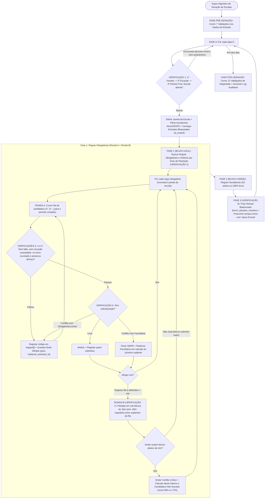

# Super Algoritmo de Geração de Escalas (Motor Híbrido SGDE)

Este documento especifica a versão final e unificada do **Motor de Geração e Edição de Escalas**, combinando:
1. **A arquitetura e as 11 entidades reais do Backend Laravel** (Regras Obrigatórias vs. Facultativas, Filas de Prioridade `1º, 2º, 3º...`, Janela de Almoço Flexível, Horários Fixos e Rotativos `weekly`/`biweekly`/`monthly`, Exceções de Horário `AssistantException` de turno especial ou `unavailable`, Faltas Totais/Parciais `Absence`, Transferências Inter-Escolas `AssistantTemporaryAssignments`, Entradas Bloqueadas `is_locked`, Filtro RGPD `is_active && !is_anonymized` e Atividade Base `"Apoio Escola"`).
2. **As melhores práticas do Protótipo SGDE e do `ScheduleGenerationService`** (8 Invariantes e Determinismo, Validações Pré e Pós-Geração, Recorte de Turnos à Janela da Escola, Rastreio de *Quem Substitui Quem*, Códigos Padronizados `skipped[]`, Partição de Tarefas em Sub-blocos de 15m quando nenhum suplente cobre o período inteiro, Realocação em Cascata de Facultativas em *Swap*, Avaliação de Impacto na Escola de Origem `causes_origin_shortfall` + `score` e Suporte Completo ao Editor Interativo Diário).

---

## 1. Regras de Ouro (Invariantes do Motor)

O motor garante matematicamente que estas **8 regras nunca são violadas**:

| Código | Invariante (Regra de Ouro) | Como é garantido |
| :--- | :--- | :--- |
| **R1** | **As atividades nunca mudam de hora:** Uma regra das `09:00–10:30` acontece sempre às `09:00–10:30` (recortada apenas se a escola abrir mais tarde ou fechar mais cedo nesse dia); apenas muda quem a executa. | Validação `post-fixed-hours` |
| **R2** | **Respeito estrito pela Fila de Prioridades da Regra:** O motor tenta sempre os titulares (`1º..min`) e depois os suplentes (`min+1..N`) definidos pelo Admin nessa regra. Nunca coloca automaticamente uma pessoa fora da lista da regra sem confirmação ou indicação explícita. | Fase 1 e Fase 2 |
| **R3** | **Ninguém trabalha fora do seu turno contratual, fora da janela da escola, em feriado ou durante uma falta:** O motor automático nunca estende o horário de saída de um assistente nem o chama na folga. | Fase 0 + Verificações 3, 4 e 5 (`post-window`, `post-blocked`) |
| **R4** | **Ninguém fica sem almoçar:** Todo o assistente com `lunch_enabled = true` tem garantido um bloco contínuo `>= lunch_duration_minutes` dentro da sua janela `[lunch_start, lunch_end]`. | Verificação 5 + Fase 3 (`post-lunch`) |
| **R5** | **Zero sobreposições (ninguém está em dois sítios à mesma hora):** Nem na mesma escola, nem em duas escolas diferentes (via transferência temporária). | Verificação 6 (`post-no-overlap`) |
| **R6** | **Hierarquia de Substituição (Troca / Swap com Realocação em Cascata):** Uma tarefa **Obrigatória** pode substituir **"Apoio Escola"** (nível mais baixo) ou uma tarefa **Facultativa** (tentando de imediato realocar a Facultativa desalojada ao próximo suplente livre da sua fila), mas **nunca** destrói outra Obrigatória nem uma entrada bloqueada manualmente (`is_locked = true`). | Verificação 6 (`post-valid-swap`) |
| **R7** | **Partição Inteligente antes de declarar Falha:** Se nenhum suplente da fila conseguir cobrir uma tarefa obrigatória inteira (ex.: 2h), o motor tenta dividir a tarefa entre dois suplentes da fila (em blocos múltiplos de 15 min, mín. 60 min seguidos) antes de emitir Alerta Crítico. | Verificação 7 — Ronda B |
| **R8** | **Determinismo Puro:** Os mesmos dados de entrada geram **sempre exatamente a mesma escala**, independentemente da ordem em que os registos vêm da base de dados. | Desempate estável por `id` ascendente (`post-deterministic`) |

---

## 2. Entidades e Modelos do Backend Envolvidos

| Conceito no Algoritmo | Modelo / Tabela no Backend | Notas de Implementação |
| :--- | :--- | :--- |
| **Horário da Escola** | `OperatingHoursResolver` (`Holiday`, `SchoolOperatingException`, `SchoolOperatingRule` + `SchoolOperatingRuleDay`) | Prioridade: `1º Feriado -> 2º Exceção da Escola -> 3º Horário Fixo`. |
| **Assistente Elegível (RGPD)** | `Assistant` + `User` | Só entram no motor assistentes com `user.is_active = true`, `deleted_at IS NULL` e `is_anonymized = false`. Possui flag `available_for_transfer`. |
| **Regras do Motor** | `ScheduleRule` + pivot `schedule_rule_assistant` | `type` (`mandatory`/`obrigatoria` vs `optional`/`facultativa`), `period_start`, `period_end`, `min`, `valid_from`, `valid_until`, `days_of_week`. Candidatos ordenados por `priority` (`1º, 2º, 3º...`). |
| **Faltas (Totais ou Parciais)** | `Absence` | `valid_from`, `valid_until`, `start_time` (opcional), `end_time` (opcional). Se `start_time = null`, falta o dia todo (`skipped: absence`). |
| **Transferências / Cedências** | `AssistantTemporaryAssignments` (`assistant_temporary_assignments`) | `assistant_id`, `origin_school_id`, `destination_school_id`, `valid_from`, `valid_until`, `start_time` (opcional), `end_time` (opcional). |
| **Exceção de Horário do Assistente** | `AssistantException` | Vigente se `valid_from <= dia <= valid_until` e `days` incluir o dia da semana (`0=Seg..6=Dom`). Se `type = 'unavailable'` (ou sem horas), bloqueia o assistente nesse dia (`skipped: unresolved_exception`). Se tiver `start_time` e `end_time` (ex.: amamentação `09:00–16:00`), **substitui o turno normal** nesse dia. |
| **Horário Normal (Fixo ou Rotativo)** | `AssistantScheduleProfile` + `AssistantScheduleShift` | Perfil em vigor na data. Suporta `fixo` e `rotativo` (`weekly`, `biweekly`, `monthly`) alinhado às semanas ISO (Segunda-feira) e meses civis. |
| **Atividade Base ("Tapa-Buracos")** | `ActivityType` (`name = 'Apoio Escola'`, `is_system = true`) | Nível mais baixo de prioridade. Preenche todos os tempos de trabalho livres na Fase 3. |
| **Escala, Rastreio e Lock** | `Schedule` (`draft`/`published`/`archived`) + `ScheduleEntry` | `ScheduleEntry` guarda `is_locked`, `replaced_assistant_id` (opcional) e `replacement_reason` (opcional) para auditoria visual de quem substituiu quem. |

### Códigos Padronizados de Rejeição de Candidatos (`skipped[]`)
Sempre que um assistente da fila de uma regra não pode ser alocado, o motor regista na resposta da API o código normalizado do motivo:
- `inactive_assistant`: Utilizador inativo, apagado ou anonimizado (`!user.is_active || deleted_at || is_anonymized`).
- `different_school`: Assistente pertence a outra escola (ou foi cedido a outra escola nesse horário).
- `absence`: Falta de dia inteiro ou falta parcial sobreposta ao horário da regra.
- `unresolved_exception`: Assistente com `AssistantException` do tipo `unavailable` nesse dia.
- `outside_working_period`: Assistente de folga nesse dia da semana ou a tarefa cai fora do seu turno `[entry_time, exit_time]`.
- `lunch_conflict`: Atribuir a tarefa deixaria o assistente com menos de `lunch_duration_minutes` contínuos livres dentro da sua janela `[lunch_start, lunch_end]`.
- `overlapping_assignment`: Já está ocupado noutra tarefa obrigatória ou entrada bloqueada (`is_locked = true`) no mesmo horário.

---

## 3. Fase Pré-Geração: Validações dos Dados de Entrada (`Pre-Flight Checks`)

Antes de gerar a escala para o intervalo `[data_inicio, data_fim]`, o motor corre **7 validações rápidas** sobre os dados de entrada para avisar o Admin de configurações incorretas:

| Código | O que verifica antes de gerar | Exemplo de Disparo | Gravidade |
| :--- | :--- | :--- | :--- |
| `pre-profile` | Todos os assistentes ativos (`is_active && !is_anonymized`) da escola têm `AssistantScheduleProfile` válido para os dias a gerar? | A Maria tem perfil que expirou a `2026-09-30` e estamos a gerar Outubro. | **Aviso** (Maria será ignorada nos dias sem perfil) |
| `pre-rotation` | Os perfis com `type = 'rotativo'` têm `starts_with` (`A` ou `B`), `rotation_period` (`weekly`, `biweekly`, `monthly`) e ambos os turnos A e B configurados? | O João é rotativo mas falta configurar o Turno B. | **Erro Bloqueante** |
| `pre-shift-window` | Os turnos dos assistentes estão contidos (ou pelo menos intersetam) o horário normal de abertura/fecho da escola? | Turno das `07:00–15:00` numa escola que só abre às `08:00`. | **Aviso** (O motor vai recortar a entrada para as `08:00`) |
| `pre-lunch-valid` | Em cada turno com `lunch_enabled = true`, o intervalo `[lunch_start, lunch_end]` está dentro do turno e tem duração `>= lunch_duration_minutes`? | Janela de almoço `12:00–12:30` (30m), mas pede `lunch_duration_minutes = 60`. | **Erro Bloqueante** |
| `pre-rules-valid` | Todas as regras ativas têm `period_start < period_end` e têm pelo menos `min` assistentes associados na lista de prioridades? | Regra "Portaria" pede `min = 2`, mas o Admin só colocou 1 assistente na regra. | **Aviso** (Vai gerar Alerta Crítico garantido nessa regra) |
| `pre-grain-15m` | Os horários de turnos, almoços e regras estão alinhados em múltiplos de 5 ou 15 minutos? | Regra com início às `09:03`. | **Aviso** |
| `pre-dow-sync` | Conversão única e coerente do dia da semana (`0 = Segunda-feira ... 6 = Domingo` em todo o motor, datas em UTC puro). | Incoerência entre `Carbon::dayOfWeek` (Dom=0) e convenção do projeto (Seg=0). | **Erro Interno** |

---

## 4. Detalhe de Todas as Verificações do Motor (Com Exemplos Comentados Caso X vs. Caso Y)

---

### VERIFICAÇÃO 1: Horário de Funcionamento da Escola no Dia, Elegibilidade RGPD e Cedências (Fase 0)
**O que está a ser verificado:**
Para cada dia `D`, o motor consulta o `OperatingHoursResolver` (`1º Feriado -> 2º Exceção da Escola -> 3º Horário Fixo`) e filtra os assistentes elegíveis (`user.is_active = true`, `deleted_at = null`, `is_anonymized = false`), identificando quem está cedido a esta escola ou desta para outra.

* **Caso A (Feriado Global ou Exceção da Escola Encerrada):**
  * *Exemplo:* Dia `2026-12-08` (Feriado) ou `SchoolOperatingException` com `is_closed = true`.
  * *O que fazemos:* `is_open = false`. O algoritmo **ignora o dia** (`continue`), devolve `reason_type` (`holiday` | `exception` | `weekend`) sem listar linhas de assistentes e não gera nenhuma entrada.
* **Caso B (Exceção da Escola Aberta com Horário Reduzido + Recorte de Turnos e Regras):**
  * *Exemplo:* O horário normal da escola é `08:00–18:00`, mas no dia `2026-12-23` há uma exceção aberta das `09:00` às `15:00`. A Maria tem turno normal das `08:00` às `16:00` e existe uma regra das `08:30` às `10:00`.
  * *O que fazemos:* O horário da escola passa a ser `09:00–15:00`. Tanto o turno da Maria (`09:00–15:00`) como a regra (`09:00–10:00`) são **recortados automaticamente à janela da escola** (`max(start, opening_time)` até `min(end, closing_time)`). Se uma regra cair totalmente fora (ex.: `15:30–17:00`), é ignorada nesse dia.
* **Caso C (Cedências / Transferências Temporárias de Entrada e Saída):**
  * *Exemplo:* O Pedro pertence à Escola B, mas tem um registo em `assistant_temporary_assignments` com `destination_school_id = Escola A` no dia `2026-10-21` das `08:00` às `13:00`.
  * *O que fazemos:* Na Escola B (origem), o Pedro fica bloqueado das `08:00–13:00` (`skipped: different_school`). Na Escola A (destino), o Pedro passa a estar disponível das `08:00–13:00`.

---

### VERIFICAÇÃO 2: Seleção e Ordenação Inteligente das Regras do Dia
**O que está a ser verificado:**
Para o dia `D`, buscamos as regras ativas onde `valid_from <= D <= valid_until` e `days_of_week` contém o dia da semana.
Separamos em dois grupos: **Fase 1 (Obrigatórias / Bloco Azul)** e **Fase 2 (Facultativas / Bloco Verde)**.

**Como ordenamos as regras dentro de cada Fase (e porquê):**
1. **1º Critério — Grau de Restrição:** `(nº de candidatos na fila da regra - regra.min)` **ascendente** (as regras com menos suplentes disponíveis correm primeiro).
2. **2º Critério — Hora de Início e Fim:** `period_start ASC, period_end ASC`.
3. **3º Critério — Determinismo:** `valid_from ASC, regra.id ASC`.

* **Exemplo Prático (Caso X vs. Caso Y):**
  * Às `09:00–10:00` há duas Regras Obrigatórias:
    * **Regra A (Portaria, `min = 1`):** Fila = `[1º Maria, 2º João, 3º Carla]` (margem = `3 - 1 = 2`).
    * **Regra B (Apoio Aluno NEE, `min = 1`):** Fila = `[1º Maria]` (margem = `1 - 1 = 0`).
  * *Sem ordenação por restrição (Caso Mau):* Se a Portaria corresse primeiro (por ter `id = 1`), escolhia a `1ª Maria`. Quando chegasse ao Apoio Aluno NEE (`id = 2`), a Maria já estava ocupada noutra obrigatória e o Aluno NEE ficava **sem ninguém**!
  * *Com a nossa ordenação (Caso Bom):* A **Regra B (Apoio Aluno NEE)** tem margem `0`, por isso corre **primeiro** e fica com a Maria. Em seguida corre a **Regra A (Portaria)**: vê que a `1ª Maria` está ocupada no Aluno NEE (`skipped: overlapping_assignment`), avança para o `2º João` (que está livre) e atribui a Portaria ao João (registando que o João entrou em substituição da titular Maria). **Ambas as regras ficam 100% cobertas!**

---

### VERIFICAÇÃO 3: Faltas (Totais ou Parciais) e Rastreio do Titular Ausente
**O que está a ser verificado:**
Ao avaliar um candidato da fila para o intervalo `[inicio, fim]`, verificamos primeiro se está ativo (`user.is_active && !is_anonymized`) e se tem falta (`Absence`) ou cedência de saída (`AssistantTemporaryAssignments`) que intersete `[inicio, fim]`.

* **Caso X (Falta de Dia Inteiro):**
  * *Exemplo:* A `1ª Maria` tem `Absence` de `2026-10-20` a `2026-10-22` com `start_time = null` e `end_time = null`.
  * *O que fazemos:* Regista `skipped[]` com `reason = 'absence'`, guarda `titular_ausente = Maria` e avança para o `2º candidato` da fila. Quando o `2º candidato` (João) assumir a vaga, a entrada do João ficará com `replaced_assistant_id = Maria.id` e `replacement_reason = 'absence'`.
* **Caso Y (Falta Parcial — Consulta Médica num horário específico):**
  * *Exemplo:* O `1º João` tem uma `Absence` no dia `2026-10-21` com `start_time = 09:00` e `end_time = 11:00`.
  * *Subcaso Y1 (Regra das `09:30` às `10:30`):* Há sobreposição (`09:30 < 11:00 && 09:00 < 10:30`). Regista `skipped: absence` e salta para o 2º da fila.
  * *Subcaso Y2 (Regra das `14:00` às `16:00`):* Não há sobreposição com `09:00–11:00`. O João já regressou da consulta -> **assume normalmente a sua tarefa da tarde!**

---

### VERIFICAÇÃO 4: Determinação do Horário de Trabalho do Assistente (`AssistantException` vs. Fixo vs. Rotativo)
**O que está a ser verificado:**
Descobrir qual o horário de trabalho contratual do assistente no dia `D`, aplicando no fim o recorte (clipping) à janela de abertura da escola.

* **Caso W (Tem `AssistantException` vigente do tipo Indisponível — `type = 'unavailable'` ou sem horas):**
  * *Exemplo:* O assistente tem uma exceção administrativa sem horas ou com `type = 'unavailable'` para hoje.
  * *O que fazemos:* Bloqueia o assistente nesse dia com `skipped: unresolved_exception` e passa ao próximo candidato.
* **Caso X (Tem `AssistantException` vigente com Horário Especial — `start_time` e `end_time`):**
  * *Exemplo:* A Carla tem uma `AssistantException` ("Horário Amamentação") de `2026-09-01` a `2026-12-31`, com `days = [0, 1, 2, 3, 4]` (Seg a Sex), `start_time = 09:00`, `end_time = 16:00`. Hoje é Quarta-feira (`2`).
  * *O que fazemos:* Substitui o turno normal e usa o horário e almoço da exceção (`09:00–16:00`).
* **Caso Y (Tem `AssistantException` vigente nas datas, mas NÃO para este dia da semana):**
  * *Exemplo:* Exceção só às Sextas-feiras (`days = [4]`), e hoje é Terça-feira (`1`).
  * *O que fazemos:* Ignora a exceção hoje e vai buscar o horário normal (`AssistantScheduleProfile`).
* **Caso Z1 (Horário Normal `fixo`):**
  * *Exemplo:* Perfil `type = 'fixo'`. Busca o turno `A` e verifica se o dia da semana atual consta em `assistant_schedule_shift_days`. Se não constar, o assistente está de **folga** hoje (`skipped: outside_working_period`).
* **Caso Z2 (Horário Normal `rotativo` — Semanal, Quinzenal ou Mensal):**
  * *Exemplo:* Perfil `type = 'rotativo'`, `valid_from = 2026-09-02` (Quarta-feira), `starts_with = 'A'`.
  * *Cálculo exato alinhado ao calendário ISO (em UTC):*
    * Seja `segunda_inicio` a Segunda-feira da semana de `valid_from` (`2026-08-31`) e `segunda_atual` a Segunda-feira da semana do dia `D`.
    * `weeksDiff = diferencaEmSemanasInteiras(segunda_inicio, segunda_atual)`.
    1. **`weekly` (Semanal — muda todas as Segundas-feiras):**
       * `indice = weeksDiff % 2`. Se `0` -> usa `starts_with`; se `1` -> usa o turno oposto (`A <-> B`).
    2. **`biweekly` (Quinzenal — muda a cada 2 Segundas-feiras):**
       * `indice = intdiv(weeksDiff, 2) % 2`. Semanas 0 e 1 -> Turno inicial; Semanas 2 e 3 -> Turno oposto.
    3. **`monthly` (Mensal — muda no dia 1 de cada mês):**
       * `monthsDiff = (anoD - anoInicio) * 12 + (mesD - mesInicio)`.
       * `indice = monthsDiff % 2`. Mês par -> Turno inicial; Mês ímpar -> Turno oposto.

---

### VERIFICAÇÃO 5: Compatibilidade de Turno e Janela Flexível de Almoço (`canFitActivityWithLunch`)
**O que está a ser verificado:**
Para o intervalo `[inicio, fim]` que queremos atribuir ao assistente:
1. Está dentro do turno efetivo do assistente hoje (`inicio >= assistente.entry_time && fim <= assistente.exit_time`)? Se não estiver, rejeita com `skipped: outside_working_period`.
2. Se o assistente tem almoço ativo (`lunch_enabled = true`), depois de descontarmos da janela `[lunch_start, lunch_end]` todas as tarefas já atribuídas hoje, eventuais faltas parciais e esta nova tarefa `[inicio, fim]`, **ainda sobra dentro de `[lunch_start, lunch_end]` pelo menos um bloco contínuo livre de duração `>= lunch_duration_minutes`**? Se não sobrar, rejeita com `skipped: lunch_conflict`.

* **Caso X (Compatível — Tarefa ocupa metade da janela de almoço):**
  * *Exemplo:* Janela de almoço `12:00–14:00`, `lunch_duration_minutes = 60`. Tarefa a testar: "Vigilância Almoço `12:00–13:00`".
  * *Cálculo:* Subtraindo `12:00–13:00` à janela `12:00–14:00`, sobra livre `13:00–14:00` (`60 min >= 60 min`).
  * *Decisão:* **Compatível!** O assistente faz a Vigilância das `12:00–13:00` e fica com o almoço garantido das `13:00–14:00`.
* **Caso Y (Incompatível — Tarefa parte a janela ao meio sem deixar 60 min seguidos):**
  * *Exemplo:* Janela de almoço `12:00–14:00` (`60 min`). Tarefa a testar: `12:30–13:30`.
  * *Cálculo:* Sobram dois pedaços livres: `12:00–12:30` (30 min) e `13:30–14:00` (30 min). O maior bloco contínuo livre é de `30 min < 60 min`.
  * *Decisão:* **Incompatível (`skipped: lunch_conflict`)!** Rejeita para proteger a hora de almoço do assistente e passa ao próximo candidato.

---

### VERIFICAÇÃO 6: Sobreposição de Atividades e Troca (`Swap` com Realocação em Cascata)
**O que está a ser verificado:**
O candidato pode trabalhar naquele horário e o almoço está seguro. Verificamos se já tem alguma atividade atribuída hoje que intersete `[inicio, fim]`.

* **No BLOCO AZUL (A processar uma Regra Obrigatória):**
  * **Caso 1 (Sem sobreposição):** Atribui a tarefa obrigatória! Se um titular anterior da fila falhou (por falta ou conflito), grava `replaced_assistant_id = titular.id`.
  * **Caso 2 (Sobrepõe com outra Regra Obrigatória ou entrada `is_locked = true`):** Não pode substituir. Mantém a obrigatória/bloqueada existente, regista `skipped: overlapping_assignment` e passa ao próximo candidato da fila.
  * **Caso 3 (Sobrepõe apenas com uma Regra Facultativa não bloqueada):**
    1. Como a Obrigatória tem nível superior à Facultativa, faz **Swap (Troca)**: remove a tarefa facultativa daquele assistente e atribui-lhe a tarefa obrigatória;
    2. Regista um Aviso Informativo (`insights[]`);
    3. **Realocação em Cascata:** Tenta de imediato realocar a Regra Facultativa desalojada ao **próximo suplente livre** da lista dessa regra facultativa!
* **No BLOCO VERDE (A processar uma Regra Facultativa):**
  * **Caso Único:** Só atribui se **não houver sobreposição nenhuma**. Uma regra facultativa nunca remove outra tarefa.

---

### VERIFICAÇÃO 7: Alocação em 2 Rondas (Integral -> Partição 15m) + Pontuação de Mobilidade Inter-Escolas
**O que está a ser verificado:**
Como cumprir o mínimo (`regra.min`) de cada Regra Obrigatória usando toda a capacidade dos suplentes da regra e, se necessário, apresentando candidatos classificados para cobertura.

#### **Ronda A — Tentativa de Cobertura Integral (`[regra.period_start, regra.period_end]`):**
* Percorre os candidatos da fila da regra por ordem de prioridade (`1º, 2º, 3º...`) tentando atribuir o bloco completo da regra.
* Assim que `atribuidos == regra.min`, **pára imediatamente (`break`)** para não gastar suplentes em excesso.

#### **Ronda B — Partição Inteligente em Sub-blocos (Só corre nas Obrigatórias se a Ronda A terminou com `atribuidos < regra.min`):**
* **Exemplo Real:**
  * A regra obrigatória "Portaria da Tarde" é das **`14:00` às `16:00`** (2 horas, `min = 1`).
  * A `1ª Maria` (titular) faltou hoje (`absence`).
  * O `2º João` (suplente) só está livre das **`14:00` às `15:00`**.
  * A `3ª Ana` (suplente) só está livre das **`15:00` às `16:00`**.
  * *O que faz a **Ronda B**:* Divide a vaga em blocos de 15 minutos (com mínimo contínuo `minStint = min(60 min, tempo restante)`), atribuindo `14:00–15:00` ao João e `15:00–16:00` à Ana. A Portaria fica **100% assegurada** pelos suplentes da própria regra!

#### **Se mesmo após a Ronda B sobrar algum bloco sem cobertura (`Conflito Crítico + Pesquisa de Candidatos`):**
Quando uma regra obrigatória continua com `assigned < min` após testar toda a sua lista (Ronda A + Ronda B), o motor gera um registo em `conflicts[]` e pesquisa automaticamente candidatos de cobertura (`findTransferCandidates`) divididos em duas listas para a **Modal de Cobertura / Transferência Temporária**:

1. **Secção 1 — Apoio Interno da Mesma Escola (fora da lista da regra):**
   * Assistentes ativos da mesma escola que estejam a trabalhar nesse horário, com almoço respeitado e sem tarefa obrigatória atribuída, ordenados pelo **menor número de minutos de tarefas específicas atribuídas no dia** (equilíbrio de carga).
2. **Secção 2 — Mobilidade Temporária Inter-Escolas (`available_for_transfer = true`):**
   * Pesquisa assistentes ativos de outras escolas ativas com `available_for_transfer = true`, turno compatível e sem falta nesse horário, calculando o **Impacto na Escola de Origem (`causes_origin_shortfall`)**:
     * **`causes_origin_shortfall = false` (`score = 96%` — Selecionável):** O assistente está apenas em *"Apoio Escola"* ou tarefa facultativa na escola de origem (retirá-lo não deixa nenhuma regra obrigatória da escola de origem abaixo do mínimo).
     * **`causes_origin_shortfall = true` (`score = 72%` — `disabled` com Tooltip de Impacto):** O assistente faz parte de uma tarefa obrigatória na escola de origem nesse horário cuja equipa ficaria abaixo do `min` se ele saísse (*Tooltip: "Indisponível / Impacto na origem: atribuído à tarefa obrigatória «X» na escola «Y»"*).
* Ao confirmar na modal, o sistema grava em `assistant_temporary_assignments` e cria a `ScheduleEntry` com **`is_locked = true`**.

---

### VERIFICAÇÃO 8: Fase 3 — Fixação Balanceada do Almoço e Preenchimento com «Apoio Escola»
**O que está a ser verificado:**
Terminadas as Fases 1 (Obrigatórias) e 2 (Facultativas), para cada assistente que trabalha hoje na escola:
1. **Fixar a Pausa Exata de Almoço (`[almoco_inicio, almoco_fim]` de duração `lunch_duration_minutes`):**
   * **Atenção:** Nunca se pinta a janela inteira `12:00–14:00` (2h) como almoço se `lunch_duration_minutes = 60`!
   * Se o assistente já tem parte da janela `[lunch_start, lunch_end]` ocupada por uma tarefa (ex.: Vigilância das `12:00–13:00`), o almoço de 60 min é fixado no bloco livre restante (`13:00–14:00`).
   * Se o assistente tem a janela `12:00–14:00` toda livre, o motor usa um **alternador balanceado** para colocar metade dos assistentes a almoçar na 1ª metade (`12:00–13:00`) e a outra metade na 2ª metade (`13:00–14:00`), garantindo que a escola nunca fica vazia à hora de almoço.
2. **Preencher os intervalos livres com `"Apoio Escola"`:**
   * Pega no turno efetivo recortado do assistente `[inicio_efetivo, fim_efetivo]` e subtrai:
     * Tarefas atribuídas (Obrigatórias, Facultativas e `is_locked`);
     * Bloco exato de almoço fixado (`lunch_duration_minutes`);
     * Faltas parciais (`Absence` com horas);
     * Cedências parciais de saída (`AssistantTemporaryAssignments` para outra escola).
   * Todos os intervalos livres que sobrarem são preenchidos com a **Atividade Base do Sistema (`ActivityType` com `is_fallback = true`, por omissão `"Apoio Escola"`)**.
   * **Regras de Domínio para a Atividade Base (`is_fallback = true`):**
     * **Sempre ativa e não eliminável:** Cada escola tem exatamente uma atividade com `is_fallback = true`, `is_system = true` e `active = true`. O administrador pode personalizar o seu **nome** e **cor**, mas não a pode desativar (`active` não pode passar a `false`) nem eliminar (`can_delete = false`).
     * **Bloqueada na criação de Regras de Horário (`ScheduleRules`):** Como o objetivo desta atividade é preencher automaticamente os tempos livres na Fase 3, ela **não pode ser selecionada** ao criar ou editar Regras de Horário (filtrada no seletor do Frontend e validada com erro `422` no `StoreScheduleRuleRequest` / `UpdateScheduleRuleRequest` do Backend).
     * **Disponível no Editor Manual de Escalas (`MatrixGrid`):** Continua disponível na paleta de pintura manual para que o administrador possa substituir blocos manualmente se desejar.

---

## 5. Fase Pós-Geração: Suite de 12 Validações Automáticas do Resultado

Imediatamente antes de devolver a escala gerada ao utilizador (e após cada edição manual no Editor Diário), o motor executa **12 verificações automáticas de integridade**:

| Código | Validação Pós-Geração | O que garante | Gravidade se falhar |
| :--- | :--- | :--- | :--- |
| `post-window` | Nenhuma entrada fora da janela da escola | Nenhuma `ScheduleEntry` começa antes de `school.opening_time` ou termina depois de `school.closing_time`. | **Erro de Motor** |
| `post-shift-bounds` | Verificação dos limites do turno | Deteta se alguma entrada cai fora do `[entry_time, exit_time]` do assistente nesse dia (no Editor Manual é permitido com aviso ao Admin). | **Aviso de Fora de Turno** |
| `post-no-overlap` | Sem sobreposições | Nenhum assistente tem duas entradas sobrepostas na mesma escola ou em escolas diferentes. | **Erro de Motor** |
| `post-blocked` | Ninguém trabalha durante ausência ou feriado | Zero entradas de trabalho em dias encerrados ou durante intervalos de `Absence` / `unavailable` / cedência de saída. | **Erro de Motor** |
| `post-lunch` | Almoço respeitado | Todos os assistentes presentes com `lunch_enabled = true` têm `>= lunch_duration_minutes` contínuos para almoço na sua janela. | **Aviso / Erro** |
| `post-locked-kept` | Entradas bloqueadas intactas | Todas as entradas que tinham `is_locked = true` antes da geração continuam exatamente iguais. | **Erro de Motor** |
| `post-fixed-hours` | Regras mantêm a hora exata | Todas as entradas geradas por regras correspondem ao intervalo `[effective_start, effective_end]` da regra. | **Erro de Motor** |
| `post-hours-sum` | Soma de horas exata | Para cada assistente: `soma(tarefas + Apoio Escola) == duracao_turno_efetivo - almoco - faltas_parciais - cedencias_saida`. | **Erro de Motor** |
| `post-coverage-mand` | Cobertura das Obrigatórias | Verifica se cada bloco de 15 min de cada regra obrigatória tem `>= min` assistentes. | **Conflito Crítico** (`conflicts[]`) |
| `post-coverage-opt` | Cobertura das Facultativas | Verifica se cada regra facultativa atingiu `min`. | **Aviso Informativo** (`insights[]`) |
| `post-school-empty` | Escola aberta sem ninguém | Verifica se há algum período em que a escola está aberta mas 0 assistentes estão em serviço. | **Aviso Informativo** |
| `post-deterministic` | Ordenação canónica | Entradas e logs ordenados por `date, start_time, assistant_id` para output 100% determinístico. | **OK** |

---

## 6. Pseudocódigo Completo do Super Algoritmo (Comentado Linha a Linha)

```text
FUNÇÃO gerarEscalasSuperMotor(school_id, data_inicio, data_fim, preserve_locked = TRUE):
    conflicts = []             // Conflitos críticos em regras obrigatórias + candidatos de transferência pontuados
    insights = []              // Avisos informativos (suplentes usados, swaps, partições, facultativas incompletas)
    log_explicativo = []       // Rasto completo de auditoria por dia

    // 1. VALIDAÇÕES PRÉ-GERAÇÃO (Pre-Flight Checks)
    pre_checks = executarValidacoesPreGeracao(school_id, data_inicio, data_fim)
    SE pre_checks.temErrosBloqueantes():
        DEVOLVER erroValidacao(pre_checks.erros)

    // 2. Carregar calendário da escola para todo o intervalo
    calendario_escola = OperatingHoursResolver.forRange(school_id, data_inicio, data_fim)

    // =========================================================================
    // FASE 0: CICLO POR CADA DATA (DIA)
    // =========================================================================
    PARA CADA dia_info EM calendario_escola:
        dia = dia_info.date
        dia_semana = dia_info.day_of_week // 0 = Segunda ... 6 = Domingo

        // VERIFICAÇÃO 1: Escola está aberta hoje? (1º Feriado -> 2º Exceção -> 3º Horário Fixo)
        SE dia_info.is_open == FALSE:
            log_explicativo.adicionar(dia, "Estabelecimento encerrado (" + dia_info.source + "). Nenhuma entrada gerada.")
            CONTINUAR PARA PRÓXIMO dia_info

        horario_escola = {
            abertura: dia_info.opening_time,
            fecho: dia_info.closing_time
        }

        // Preservar entradas bloqueadas pelo Admin (se preserve_locked == TRUE)
        atribuicoes_do_dia = preserve_locked ? carregarEntradasBloqueadas(school_id, dia) : []
        apagarEntradasNaoBloqueadas(school_id, dia, preserve_locked)

        // =========================================================================
        // FASE 1 (BLOCO AZUL): REGRAS OBRIGATÓRIAS (Ronda A Integral + Ronda B Partição)
        // =========================================================================
        regras_obrigatorias = buscarRegrasValidasNoDia(school_id, dia, dia_semana, tipo = "mandatory")

        // VERIFICAÇÃO 2: Ordenar por Grau de Restrição (nº candidatos - min ASC), period_start ASC, period_end ASC, id ASC
        ordenarPorRestricaoHoraEId(regras_obrigatorias)

        PARA CADA regra EM regras_obrigatorias:
            // Truncar período da regra às horas de funcionamento da escola no dia
            inicio_efetivo_regra = max(regra.period_start, horario_escola.abertura)
            fim_efetivo_regra = min(regra.period_end, horario_escola.fecho)
            SE fim_efetivo_regra <= inicio_efetivo_regra:
                CONTINUAR PARA PRÓXIMA regra

            intervalo_regra = [inicio_efetivo_regra, fim_efetivo_regra]
            atribuidos = contarBloqueadosNaRegra(atribuicoes_do_dia, regra, intervalo_regra)
            skipped = []                // Lista de candidatos ignorados com código padronizado
            titulares_que_falharam = [] // Rastreia titulares para preencher 'replaced_assistant_id'

            // -----------------------------------------------------------------
            // RONDA A: Tentar atribuir o período completo [inicio_efetivo_regra, fim_efetivo_regra]
            // -----------------------------------------------------------------
            PARA CADA candidato EM regra.assistentes_por_prioridade:
                SE atribuidos >= regra.min:
                    SAIR DO CICLO (break) // Meta 'min' atingida!

                assistente = candidato.assistente

                // Filtro de segurança e RGPD
                SE NÃO assistenteElegivelRGPD(assistente):
                    skipped.adicionar({ assistant_id: assistente.id, priority: candidato.priority, reason: "inactive_assistant" })
                    CONTINUAR

                // VERIFICAÇÃO 3: Falta (total/parcial) ou cedência de saída neste horário?
                codigo_ausencia = verificarFaltaOuCedenciaSaida(assistente.id, school_id, dia, intervalo_regra)
                SE codigo_ausencia != NULO: // 'absence' ou 'different_school'
                    skipped.adicionar({ assistant_id: assistente.id, priority: candidato.priority, reason: codigo_ausencia })
                    titulares_que_falharam.adicionar({ assistente: assistente, motivo: codigo_ausencia })
                    CONTINUAR

                // VERIFICAÇÃO 4: Exceção ('unavailable' vs horário especial) ou Horário Normal (Fixo / Rotativo A/B)
                res_horario = resolverHorarioEfetivoRecortado(assistente.id, dia, dia_semana, horario_escola)
                SE res_horario.status != "ok": // 'unresolved_exception' ou 'outside_working_period'
                    skipped.adicionar({ assistant_id: assistente.id, priority: candidato.priority, reason: res_horario.reason })
                    titulares_que_falharam.adicionar({ assistente: assistente, motivo: res_horario.reason })
                    CONTINUAR

                horario_assistente = res_horario.schedule

                // VERIFICAÇÃO 5: Cabe no turno e preserva >= lunch_duration_minutes contínuos na janela de almoço?
                SE intervalo_regra.inicio < horario_assistente.entry_time OU intervalo_regra.fim > horario_assistente.exit_time:
                    skipped.adicionar({ assistant_id: assistente.id, priority: candidato.priority, reason: "outside_working_period" })
                    titulares_que_falharam.adicionar({ assistente: assistente, motivo: "outside_working_period" })
                    CONTINUAR

                tarefas_atuais = obterTarefasDoAssistenteNoDia(atribuicoes_do_dia, assistente.id)
                SE NÃO canFitActivityWithLunch(horario_assistente, tarefas_atuais, intervalo_regra):
                    skipped.adicionar({ assistant_id: assistente.id, priority: candidato.priority, reason: "lunch_conflict" })
                    titulares_que_falharam.adicionar({ assistente: assistente, motivo: "lunch_conflict" })
                    CONTINUAR

                // VERIFICAÇÃO 6: Sobreposição de atividades
                conflitos = obterTarefasSobrepostas(tarefas_atuais, intervalo_regra)

                SE conflitos ESTÁ VAZIO:
                    titular_substituido = retirarPrimeiroTitularFalhado(titulares_que_falharam)
                    adicionarAtribuicao(
                        atribuicoes_do_dia, assistente.id, regra, intervalo_regra,
                        tipo = "mandatory",
                        replaced_assistant_id = titular_substituido?.assistente.id,
                        replacement_reason = titular_substituido?.motivo
                    )
                    atribuidos++
                    SE titular_substituido != NULO OU candidato.priority > regra.min:
                        insights.adicionar(
                            dia + " [" + regra.activity_name + "]: Suplente " + assistente.nome +
                            " (" + candidato.priority + "º) assumiu a vaga."
                        )
                SENÃO SE algumConflitoEObrigatorioOuBloqueado(conflitos):
                    skipped.adicionar({ assistant_id: assistente.id, priority: candidato.priority, reason: "overlapping_assignment" })
                    titulares_que_falharam.adicionar({ assistente: assistente, motivo: "overlapping_assignment" })
                    CONTINUAR
                SENÃO:
                    // Conflito apenas com tarefa(s) Facultativa(s) -> Faz SWAP + Realocação em Cascata da Facultativa!
                    removerAtribuicoes(atribuicoes_do_dia, conflitos)
                    titular_substituido = retirarPrimeiroTitularFalhado(titulares_que_falharam)
                    adicionarAtribuicao(
                        atribuicoes_do_dia, assistente.id, regra, intervalo_regra,
                        tipo = "mandatory",
                        replaced_assistant_id = titular_substituido?.assistente.id,
                        replacement_reason = "optional_swap"
                    )
                    atribuidos++
                    PARA CADA fac_desalojada EM conflitos:
                        realocarFacultativaParaProximoSuplente(atribuicoes_do_dia, fac_desalojada.regra, dia, dia_semana, horario_escola)
                    insights.adicionar(
                        dia + ": Tarefa facultativa de " + assistente.nome + " substituída pela obrigatória " + regra.activity_name
                    )

            // -----------------------------------------------------------------
            // RONDA B: Partição em Sub-blocos de 15 min (se atribuidos < regra.min)
            // -----------------------------------------------------------------
            ENQUANTO atribuidos < regra.min:
                progrediu_na_vaga = FALSE
                cursor_tempo = inicio_efetivo_regra
                titular_substituido = retirarPrimeiroTitularFalhado(titulares_que_falharam)

                ENQUANTO cursor_tempo < fim_efetivo_regra:
                    duracao_restante = fim_efetivo_regra - cursor_tempo
                    min_stint = min(60 minutos, duracao_restante)

                    melhor_sub = escolherMelhorSuplenteParaSubBloco(
                        regra.assistentes_por_prioridade, atribuicoes_do_dia, school_id, dia, dia_semana,
                        horario_escola, cursor_tempo, fim_efetivo_regra, min_stint
                    )

                    SE melhor_sub != NULO:
                        sub_intervalo = [cursor_tempo, melhor_sub.fim_possivel]
                        SE melhor_sub.conflitos_facultativos NÃO ESTÁ VAZIO:
                            removerAtribuicoesParciais(atribuicoes_do_dia, melhor_sub.conflitos_facultativos, sub_intervalo)

                        adicionarAtribuicao(
                            atribuicoes_do_dia, melhor_sub.assistente.id, regra, sub_intervalo,
                            tipo = "mandatory",
                            replaced_assistant_id = titular_substituido?.assistente.id,
                            replacement_reason = "partition_sub_block"
                        )
                        insights.adicionar(
                            dia + " [" + regra.activity_name + "]: Partição " + formatar(sub_intervalo) +
                            " assegurada por " + melhor_sub.assistente.nome
                        )
                        cursor_tempo = melhor_sub.fim_possivel
                        progrediu_na_vaga = TRUE
                    SENÃO:
                        cursor_tempo = cursor_tempo + 15 minutos

                SE NÃO progrediu_na_vaga:
                    SAIR DO CICLO ENQUANTO (break)
                SENÃO:
                    atribuidos++

            // -----------------------------------------------------------------
            // Verificação final de cobertura da Regra Obrigatória + Pesquisa de Candidatos
            // -----------------------------------------------------------------
            buracos_da_regra = detetarBlocosAbaixoDoMinimo(atribuicoes_do_dia, regra, intervalo_regra)
            PARA CADA buraco EM buracos_da_regra:
                // Pesquisar apoios internos livres da mesma escola + candidatos de outras escolas (com score 96% vs 72%)
                internal_candidates = findInternalSchoolCandidates(school_id, dia, dia_semana, [buraco.inicio, buraco.fim], atribuicoes_do_dia)
                transfer_candidates = findTransferCandidates(school_id, dia, dia_semana, [buraco.inicio, buraco.fim])

                conflicts.adicionar({
                    date: dia,
                    rule_id: regra.id,
                    activity_name: regra.activity_name,
                    period_start: buraco.inicio,
                    period_end: buraco.fim,
                    required: regra.min,
                    assigned: buraco.atribuidos,
                    missing: regra.min - buraco.atribuidos,
                    skipped: skipped,
                    internal_candidates: internal_candidates,
                    transfer_candidates: transfer_candidates
                })

        // =========================================================================
        // FASE 2 (BLOCO VERDE): REGRAS FACULTATIVAS
        // =========================================================================
        regras_facultativas = buscarRegrasValidasNoDia(school_id, dia, dia_semana, tipo = "optional")
        ordenarPorRestricaoHoraEId(regras_facultativas)

        PARA CADA regra EM regras_facultativas:
            inicio_efetivo_regra = max(regra.period_start, horario_escola.abertura)
            fim_efetivo_regra = min(regra.period_end, horario_escola.fecho)
            SE fim_efetivo_regra <= inicio_efetivo_regra:
                CONTINUAR

            intervalo_regra = [inicio_efetivo_regra, fim_efetivo_regra]
            atribuidos = contarBloqueadosNaRegra(atribuicoes_do_dia, regra, intervalo_regra)

            PARA CADA candidato EM regra.assistentes_por_prioridade:
                SE atribuidos >= regra.min:
                    SAIR DO CICLO (break)

                assistente = candidato.assistente
                SE NÃO assistenteElegivelRGPD(assistente):
                    CONTINUAR
                SE verificarFaltaOuCedenciaSaida(assistente.id, school_id, dia, intervalo_regra) != NULO:
                    CONTINUAR

                res_horario = resolverHorarioEfetivoRecortado(assistente.id, dia, dia_semana, horario_escola)
                SE res_horario.status != "ok":
                    CONTINUAR

                horario_assistente = res_horario.schedule
                SE intervalo_regra.inicio < horario_assistente.entry_time OU intervalo_regra.fim > horario_assistente.exit_time:
                    CONTINUAR

                tarefas_atuais = obterTarefasDoAssistenteNoDia(atribuicoes_do_dia, assistente.id)
                SE NÃO canFitActivityWithLunch(horario_assistente, tarefas_atuais, intervalo_regra):
                    CONTINUAR

                // No Bloco Verde (Facultativas) só atribui se estiver 100% livre
                SE obterTarefasSobrepostas(tarefas_atuais, intervalo_regra) ESTÁ VAZIO:
                    adicionarAtribuicao(atribuicoes_do_dia, assistente.id, regra, intervalo_regra, tipo = "optional")
                    atribuidos++

            SE atribuidos < regra.min:
                insights.adicionar(
                    dia + ": Regra facultativa '" + regra.activity_name + "' ficou com " + atribuidos + "/" + regra.min
                )

        // =========================================================================
        // FASE 3 (VERIFICAÇÃO 8): ALMOÇO BALANCEADO E PREENCHIMENTO COM "APOIO ESCOLA"
        // =========================================================================
        assistentes_hoje = buscarAssistentesElegiveisMaisCedidosEntrada(school_id, dia)
        ordenarPorId(assistentes_hoje) // Garante determinismo (Invariante R8)
        alternador_almoco = 0

        PARA CADA assistente EM assistentes_hoje:
            SE temFaltaDiaInteiro(assistente.id, dia):
                CONTINUAR

            res_horario = resolverHorarioEfetivoRecortado(assistente.id, dia, dia_semana, horario_escola)
            SE res_horario.status != "ok":
                CONTINUAR

            horario_assistente = res_horario.schedule
            tarefas_atuais = obterTarefasDoAssistenteNoDia(atribuicoes_do_dia, assistente.id)

            // 1. Fixar o bloco exato de almoço (de duração 'lunch_duration_minutes') dentro de [lunch_start, lunch_end]
            bloco_almoco = NULO
            SE horario_assistente.lunch_enabled == TRUE:
                bloco_almoco = escolherBlocoDeAlmocoBalanceado(horario_assistente, tarefas_atuais, alternador_almoco)
                alternador_almoco++

            // 2. Subtrair tarefas + almoço + faltas parciais + cedências de saída ao turno efetivo
            periodos_ocupados = juntar(
                tarefas_atuais,
                bloco_almoco,
                obterFaltasParciais(assistente.id, dia),
                obterCedenciasParciaisSaida(assistente.id, school_id, dia)
            )

            buracos_livres = subtrairIntervalos(
                [horario_assistente.entry_time, horario_assistente.exit_time],
                periodos_ocupados
            )

            // 3. Preencher todos os períodos de trabalho livres com "Apoio Escola"
            PARA CADA intervalo_livre EM buracos_livres:
                adicionarAtribuicaoApoioEscola(atribuicoes_do_dia, assistente.id, dia, intervalo_livre.inicio, intervalo_livre.fim)

        guardarEntradasNaBaseDeDados(school_id, dia, atribuicoes_do_dia)

    // 3. VALIDAÇÕES PÓS-GERAÇÃO (12 verificações matemáticas sobre a escala gerada)
    post_checks = executarValidacoesPosGeracao(school_id, data_inicio, data_fim)

    DEVOLVER {
        status: "draft",
        conflicts: conflicts,
        insights: insights,
        validations: { pre: pre_checks, post: post_checks },
        audit_log: log_explicativo
    }
```

---

## 7. Diagrama de Fluxo do Super Algoritmo (Mermaid)



---

## 8. Suporte do Algoritmo ao Editor Interativo de Escalas (Modo de Edição Manual)

A estrutura do Super Algoritmo suporta diretamente todas as funcionalidades do **Editor Interativo Diário** para o Administrador:

1. **Marcação em Background do Horário do Assistente no Dia (`shift_bounds`):**
   - Para cada dia `D`, o Backend devolve através de `resolverHorarioEfetivoRecortado(assistente_id, D)` os limites exatos do turno daquele assistente nesse dia (`entry_time`, `exit_time`, `lunch_start`, `lunch_end`, `lunch_duration_minutes`).
   - No modo de edição, a linha de cada assistente desenha em background a moldura tracejada do seu turno nesse dia, com margem interna folgada para as barras em cápsula.
   - Se o Admin pintar manualmente um bloco de 15 min fora de `[entry_time, exit_time]`, o sistema **permite gravar** a entrada manual (`is_locked = true`), mas a validação `post-shift-bounds` devolve em tempo real um **Aviso de Fora de Turno** (*"Pintou X min fora do horário definido para hoje"*).

2. **Assistentes Ausentes Agrupados no Fim (`disabled`) com Horário Real e Tarefas que Estariam a seu Cargo:**
   - Uma falta (`Absence`) **nunca** é representada como um bloco de 24h (`00:00–24:00`), mas sim estritamente recortada ao horário que o assistente faria nesse dia (`[entry_time, exit_time]`, ou `[absence.start_time, absence.end_time]` se for falta parcial).
   - Para os assistentes com falta no dia `D`, o motor calcula as **tarefas que estariam a seu cargo** (onde o assistente ausente era titular prioritário nas regras ativas daquele dia) e devolve-as como `planned_tasks`.
   - Na grelha, os assistentes com falta aparecem no **fim da lista**, bloqueados para edição (`disabled`), exibindo dentro do seu horário previsto as tarefas tracejadas que ficaram órfãs por causa da sua ausência.

3. **Navegação por Dias no Editor + Filtro de Atividades, Regras do Dia e «Focus Mode»:**
   - Quando o Admin navega entre dias (`< Dia Anterior | Seguinte >`) dentro do Modo de Edição, o motor filtra automaticamente:
     - As **Regras Estabelecidas para esse Dia da Semana** (`buscarRegrasValidasNoDia`);
     - A paleta de **Atividades aplicáveis nesse dia** (excluindo `"Ausente"` do pincel manual, pois as ausências vêm do módulo próprio).
   - Ao selecionar uma atividade para pintar, o Editor ativa o **Destaque Visual («Focus Mode»)** tanto nos cartões de regras dessa atividade como nos blocos correspondentes do mapa de escalas.

4. **Secção de Feedback & Avisos em Tempo Real (Live Validation):**
   - Sempre que o Admin altera blocos no editor, as validações pós-geração (`post-coverage-mand`, `post-coverage-opt`, `post-shift-bounds`, `post-lunch`) reavaliam a matriz do dia e devolvem feedback instantâneo:
     - **Estado de cada Regra do Dia:** ex.: `2/2 Cumprida` (verde) vs. `1/2 Em falta` (vermelho se obrigatória, âmbar se facultativa);
     - **Avisos de Fora de Turno:** blocos pintados fora do horário normal do assistente;
     - **Avisos de Pausa de Almoço:** se uma edição manual eliminou a janela mínima de almoço de um assistente.

5. **Dias com Estabelecimento Encerrado (Fins de Semana, Feriados e Exceções Encerradas):**
   - Quando `dia_info.is_open == false` (Verificação 1), a API devolve `is_open: false`, `reason_type` (`weekend` | `holiday` | `exception`) e a descrição do encerramento, **sem listar linhas de assistentes**, apresentando apenas o aviso de estabelecimento encerrado no Dashboard.

6. **Bloqueio de Edição em Dias Passados (`date < today`):**
   - Escalas de datas passadas são imutáveis (`read-only`): permitem visualização completa e podem servir como **data de origem** para copiar uma escala, mas não permitem edição/pintura de blocos.

7. **Funcionalidade «Copiar Escala de Outro Dia» (`copyDaySchedule`):**
   - O Admin pode escolher uma data de origem `D_origem` (passada ou futura em que a escola esteja aberta) e copiar a escala para o dia atual `D_destino` (`D_destino >= hoje`):
     - Para os assistentes **presentes** em `D_destino`: copia as entradas de `D_origem` (marcando-as em rascunho/edição e executando de imediato as validações das regras de `D_destino` e dos limites de turno de `D_destino`).
     - Para os assistentes **com falta** em `D_destino`: **não** cria entradas ativas de trabalho; mantém o assistente agrupado no fim da lista como `disabled` (secção de Ausentes), mas preenche o seu `planned_tasks` com as tarefas que ele tinha atribuídas na escala copiada de `D_origem`, para que o Admin veja exatamente que tarefas da escala copiada ficaram por cobrir devido à falta desse assistente hoje.

8. **Modal de Validação e Confirmação Multi-Dia ao Concluir Edição:**
   - Como o Admin pode navegar entre vários dias dentro do Modo de Edição, o sistema mantém um dicionário de rascunhos por data (`draftMatricesByDay[date]`).
   - Ao clicar em **Concluir Edição**, é apresentada uma modal de resumo que lista **apenas os dias que sofreram alterações** (ex.: Dia X, Dia Y), o número de assistentes modificados e os avisos de validação de cada dia, permitindo descartar individualmente qualquer dia alterado por engano antes de gravar em definitivo no Backend.
